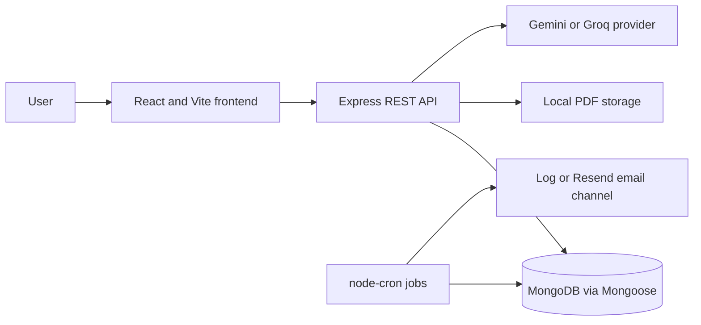

# ClauseGuard

ClauseGuard is an AI-assisted contract obligation management system. It extracts potential obligations from uploaded PDF contracts and gives users a review workflow to decide what to track.

## The problem

Contract deadlines and commitments can be difficult to find and manage across documents. ClauseGuard helps surface candidate obligations and organize their follow-up while keeping people responsible for review and decisions.

## Workflow and features

1. A registered user uploads a PDF contract.
2. The backend extracts PDF text and asks a configured Gemini or Groq provider for potential obligations.
3. Suggestions are saved with `potential` status and shown for human review. AI output is not a verified legal obligation or legal advice.
4. A user can confirm, reject, or edit suggestions.
5. Confirmed obligations can be tracked, marked complete, and given reminders.
6. The backend scheduler dispatches due reminders through the selected log or email channel and marks confirmed obligations overdue when their deadline passes.

Other implemented areas include account registration and login, password recovery, contract and obligation lists, dashboards, reminder management, request validation, ownership checks, and PDF upload validation.

## Architecture



Contract processing is handed off in-process with `setImmediate`; it is not backed by a durable job queue. Uploaded files are stored on the backend's local filesystem by default.

## Tech stack

- **Frontend:** React, TypeScript, Vite, React Router, Axios, Zustand, Tailwind CSS, Radix UI, Motion, Recharts.
- **Backend:** Node.js 22.13+, Express, TypeScript, MongoDB/Mongoose, Zod, Multer, pdfjs-dist, Gemini and Groq provider integrations, Jest, Supertest, Resend HTTP integration, and node-cron.

## Repository structure

```text
.
├── frontend/     React application and frontend documentation
├── backend/      Express API, processing services, jobs, and backend tests
└── README.md     Monorepo overview and setup
```

Each application has its own `package.json`, lockfile, and install step. Run commands from that application's directory.

## Prerequisites

- Node.js 22.13.0 or newer (required by the backend and compatible with Vite 8).
- npm.
- MongoDB for running the backend.
- An API key for the selected AI provider to process contracts. The backend can start without an AI key, but contract analysis will fail until configured.

## Backend setup

From the repository root:

```bash
cd backend
npm install
cp .env.example .env
```

On Windows PowerShell, use `Copy-Item .env.example .env` in place of `cp`. Set at least `MONGODB_URI` and a randomly generated `JWT_SECRET` of 32 or more characters in `backend/.env`. Select `AI_PROVIDER=gemini` or `AI_PROVIDER=groq` and configure the matching provider key if you want contract analysis. Never commit `.env` or put secrets in frontend variables.

Start MongoDB separately, then run the API:

```bash
npm run dev
```

The backend listens on port 4000 by default. See [backend/README.md](backend/README.md) for all environment options, database setup, API details, and scheduler behavior.

## Frontend setup

In another terminal:

```bash
cd frontend
npm install
npm run dev
```

Vite serves the frontend at `http://localhost:5173` and proxies `/api` to `http://localhost:4000` by default. To use another API base URL, create `frontend/.env.local` with `VITE_API_BASE_URL` set to that URL. Vite-exposed variables are public in the built client; never place credentials in them. See [frontend/README.md](frontend/README.md) for details.

## Development commands

Run these from `frontend/` or `backend/` as appropriate:

| Purpose | Frontend | Backend |
| --- | --- | --- |
| Development server | `npm run dev` | `npm run dev` |
| Type check | `npm run typecheck` | `npm run typecheck` |
| Lint | `npm run lint` | `npm run lint` |
| Production build | `npm run build` | `npm run build` |
| Test suite | — | `npm test` |

Frontend `npm run build` runs TypeScript project checks before Vite builds. Backend `npm test` runs unit tests and database-backed suites; suites requiring MongoDB are skipped unless `TEST_MONGODB_URI` points to a disposable test database. Those suites clear collections and drop that database, so do not use a production or valuable database URI. Tests stub AI providers and should not call live AI APIs.

## API overview

The API base path is `/api`. Route groups include:

- `GET /health` and `GET /health/ready`
- `/auth` and `/users` for authentication and account operations
- `/contracts` for PDF upload, listing, details, and deletion
- `/obligations` for suggestion review and obligation management
- `/reminders` for reminder scheduling and management

See the route files in `backend/src/routes/` and the detailed endpoint tables in [backend/README.md](backend/README.md). Responses use a common success/error envelope.

## Security considerations

- Keep backend secrets in ignored environment files and use strong, unique values outside local development.
- Contract files and extracted text are sensitive. The default storage is local disk; configure access, backups, retention, and deletion policies appropriately before handling real contracts.
- Uploaded PDF text is sent to the configured AI provider for analysis. Review that provider's data handling terms before using confidential documents.
- Set `CORS_ORIGIN` to explicit HTTPS frontend origins for production. The non-production wildcard mode does not enable credentialed CORS. Reminder delivery logs contain operational identifiers and dates, not obligation titles or user-provided reminder messages.
- The API applies authentication, resource ownership checks, input validation, upload limits, rate limiting, and security headers. These measures do not replace a deployment security review.
- AI output can be incomplete or incorrect. Review suggestions before treating them as obligations or relying on deadlines.

## Current limitations

- AI suggestions are not legally accurate or verified; a human review step is required.
- Contract processing runs in-process rather than through a durable queue. Work may be lost if the process stops during analysis.
- Files are stored on local disk, which is not shared storage for multi-instance deployments.
- The scheduler is in-process. Email requires valid Resend configuration and a sender domain verified with Resend; Resend test mode may restrict recipients. Real email delivery has not been verified for this repository. The default reminder channel is the application log.
- Database-backed tests need an isolated MongoDB test database. They are skipped when `TEST_MONGODB_URI` is not set.
- No deployment is documented or verified. This repository does not currently include a license; do not assume permission to reuse it until a license is selected and added.

## Future improvements

- Move contract processing to a durable background queue and uploads to managed object storage.
- Add operational monitoring and deployment guidance, including a shared scheduler strategy for multiple instances.
- Add OCR or another supported workflow for scanned PDFs, and consider chunking long contracts.
- Expand integration and end-to-end validation against isolated services and representative documents.
- Select and add an appropriate open-source license before accepting public reuse or contributions.
