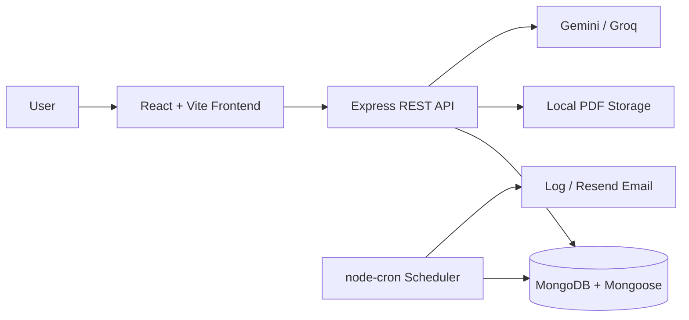

# ClauseGuard

**AI-assisted contract obligation management with human-in-the-loop review.**

ClauseGuard extracts potential obligations from PDF contracts and helps users review, organize, and track important commitments and deadlines.

AI identifies candidates; **people make the decisions.** Suggestions remain in a `potential` state until a user reviews them. AI-generated output is not verified legal advice.

## The problem

Contract deadlines, responsibilities, and commitments can be difficult to identify and manage across multiple documents.

ClauseGuard provides a workflow to:

- Extract potential obligations from uploaded PDF contracts.
- Review AI-generated suggestions before accepting them.
- Organize confirmed obligations and track their status.
- Manage reminders and monitor approaching deadlines.

## Key features

- **PDF contract processing:** Upload PDF documents and extract their text.
- **AI-assisted analysis:** Generate potential obligations using Gemini or Groq.
- **Human review workflow:** Confirm, reject, or edit AI-generated suggestions.
- **Obligation management:** Track confirmed obligations and mark them complete.
- **Reminder management:** Create and manage reminders for important deadlines.
- **Dashboard:** View contract, obligation, and reminder information.
- **Authentication:** Account registration, login, and password recovery.
- **Background scheduling:** Process due reminders and identify overdue obligations.

## How it works

1. A registered user uploads a PDF contract.
2. The backend extracts the document text.
3. The configured Gemini or Groq provider analyzes the extracted text.
4. AI-generated suggestions are stored with `potential` status.
5. The user reviews each suggestion and can confirm, reject, or edit it.
6. Confirmed obligations can be tracked, completed, and assigned reminders.
7. The scheduler dispatches due reminders through the configured log or email channel and marks obligations overdue when their deadlines pass.

**Important:** AI-generated suggestions may be incomplete or incorrect. Human review is required before treating a suggestion as an actual obligation.

## Architecture



Contract processing is handed off using `setImmediate`. It does not use a durable background job queue. Uploaded files are stored on the backend's local filesystem by default.

## Technology stack

| Layer | Technologies |
|---|---|
| Frontend | React, TypeScript, Vite |
| Routing | React Router |
| State management | Zustand |
| Styling and UI | Tailwind CSS, Radix UI |
| Animation and charts | Motion, Recharts |
| HTTP client | Axios |
| Backend | Node.js, Express, TypeScript |
| Database | MongoDB, Mongoose |
| Validation | Zod |
| PDF processing | Multer, pdfjs-dist |
| AI integration | Gemini, Groq |
| Scheduling | node-cron |
| Email | Resend HTTP integration |
| Testing | Jest, Supertest |

## Repository structure

```text
ClauseGuard/
├── frontend/
│   ├── src/
│   │   ├── api/
│   │   ├── components/
│   │   ├── hooks/
│   │   ├── pages/
│   │   ├── routes/
│   │   ├── store/
│   │   └── types/
│   ├── package.json
│   └── README.md
│
├── backend/
│   ├── src/
│   │   ├── config/
│   │   ├── controllers/
│   │   ├── jobs/
│   │   ├── middleware/
│   │   ├── models/
│   │   ├── routes/
│   │   ├── services/
│   │   ├── types/
│   │   ├── utils/
│   │   └── validators/
│   ├── tests/
│   ├── package.json
│   └── README.md
│
├── .gitignore
└── README.md
```

The frontend and backend are separate applications, each with its own `package.json` and lockfile.

## Getting started

### Prerequisites

- Node.js 22.13.0 or newer.
- npm.
- MongoDB.
- An API key for Gemini or Groq if you want to use contract analysis.

### 1. Clone the repository

```bash
git clone https://github.com/mirzaruntime/ClauseGuard.git
cd ClauseGuard
```

### 2. Configure the backend

```bash
cd backend
npm ci
```

Create your environment file:

```powershell
Copy-Item .env.example .env
```

Configure at least:

- `MONGODB_URI` — MongoDB connection string.
- `JWT_SECRET` — Randomly generated secret containing at least 32 characters.
- `AI_PROVIDER` — Select `gemini` or `groq`.
- The corresponding AI provider API key if contract analysis is required.

Start MongoDB separately.

Start the backend development server:

```bash
npm run dev
```

The backend listens on port `4000` by default.

Refer to [backend/README.md](backend/README.md) for the complete environment configuration, API documentation, database setup, and scheduler details.

### 3. Configure the frontend

Open another terminal:

```bash
cd frontend
npm ci
npm run dev
```

Vite serves the frontend at:

```text
http://localhost:5173
```

By default, API requests under `/api` are proxied to:

```text
http://localhost:4000
```

To use a different backend URL, create `frontend/.env.local` and configure:

```env
VITE_API_BASE_URL=http://localhost:4000/api
```

Never place private credentials or API keys in frontend environment variables. Vite-exposed variables are included in the client-side build.

Refer to [frontend/README.md](frontend/README.md) for additional frontend configuration details.

## Development commands

Run the commands from the appropriate application directory.

| Command | Frontend | Backend |
|---|---|---|
| Install dependencies | `npm ci` | `npm ci` |
| Development server | `npm run dev` | `npm run dev` |
| Type checking | `npm run typecheck` | `npm run typecheck` |
| Linting | `npm run lint` | `npm run lint` |
| Production build | `npm run build` | `npm run build` |
| Tests | — | `npm test` |

The frontend production build runs TypeScript project checks before Vite builds the application.

Backend tests include unit and database-backed suites. Integration suites requiring MongoDB are skipped unless `TEST_MONGODB_URI` points to a disposable test database.

**Warning:** Database-backed tests clear collections and drop their configured test database. Never use a production or valuable database URI. AI providers are stubbed in tests and should not call live AI APIs.

## API overview

The API base path is `/api`.

| Route group | Purpose |
|---|---|
| `/health` | Health checks |
| `/health/ready` | Database readiness check |
| `/auth` | Authentication and password recovery |
| `/users` | Account operations |
| `/contracts` | PDF upload, listing, details, and deletion |
| `/obligations` | Suggestion review and obligation management |
| `/reminders` | Reminder scheduling and management |

See `backend/src/routes/` and [backend/README.md](backend/README.md) for the endpoint details.

API responses use a common success/error response envelope.

## Security and data handling

- Backend secrets belong in environment variables, never in committed source code.
- Use strong, unique secrets outside local development.
- Contract documents and extracted text may contain confidential information.
- Uploaded PDF text is sent to the configured AI provider for analysis. Review that provider's data handling terms before submitting confidential documents.
- Default file storage is local disk. Production deployments need appropriate access controls, retention policies, backups, and deletion procedures.
- Configure `CORS_ORIGIN` with explicit HTTPS frontend origins in production.
- The API implements authentication, resource ownership checks, input validation, upload limits, rate limiting, and security headers.
- AI-generated suggestions must be reviewed before being treated as obligations or relying on their deadlines.

These controls do not replace a proper production security review.

## Current limitations

- AI suggestions are not verified legal obligations or legal advice.
- Contract processing uses in-process execution rather than a durable job queue. Work may be lost if the backend stops during analysis.
- Uploaded files use local filesystem storage by default, which is unsuitable as shared storage for multiple backend instances.
- The scheduler runs in-process.
- Email delivery requires valid Resend configuration and a sender domain verified with Resend. Real email delivery has not been verified for this repository.
- The default reminder channel is the application log.
- Database-backed integration tests require an isolated MongoDB test database.
- No production deployment has been verified.
- The repository currently has no license. Public visibility does not automatically grant permission to reuse its code.

## Future improvements

- Introduce a durable background job queue for contract processing.
- Move uploaded documents to managed object storage.
- Add OCR support for scanned PDFs.
- Implement chunking for long contracts.
- Improve monitoring and production deployment guidance.
- Establish a shared scheduler strategy for multiple backend instances.
- Expand integration and end-to-end testing.
- Select and add an appropriate open-source license.

---

**Built by [mirzaruntime](https://github.com/mirzaruntime)**

[GitHub Repository](https://github.com/mirzaruntime/ClauseGuard)